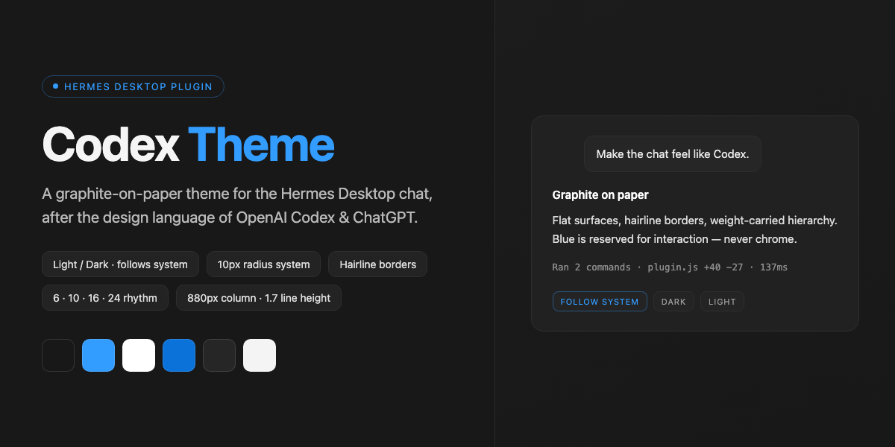
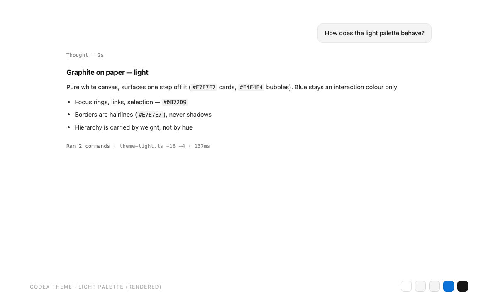
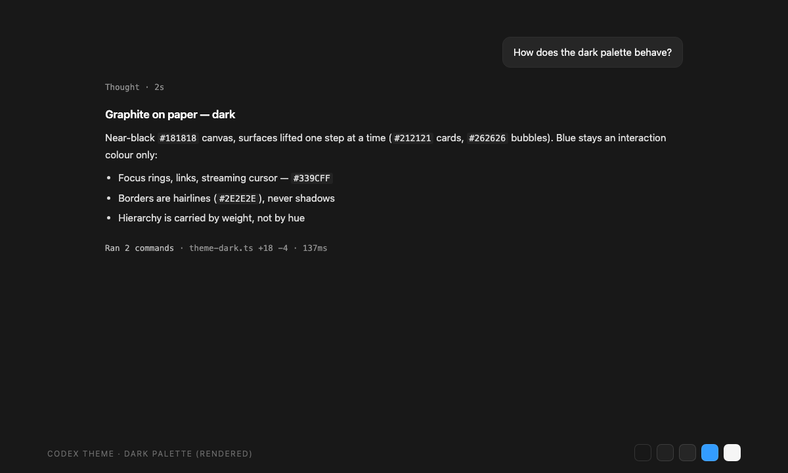

<p align="center">
  
</p>

<h1 align="center">Codex Theme</h1>

<p align="center">
  <em>A graphite-on-paper theme for the Hermes Desktop chat — after the design language of OpenAI Codex &amp; ChatGPT</em>
</p>

<p align="center">
  <a href="LICENSE"></a>
  <a href="https://hermes-agent.nousresearch.com/docs"></a>
  <a href="https://hermes-agent.nousresearch.com/docs/developer-guide/desktop-plugin-sdk"></a>
</p>

<p align="center">
  <a href="#highlights">Highlights</a> •
  <a href="#screenshots">Screenshots</a> •
  <a href="#install">Install</a> •
  <a href="#settings">Settings</a> •
  <a href="README.zh-CN.md">简体中文</a>
</p>

Dual light/dark palettes that follow your system appearance, with typography,
radii and spacing tuned after the design language of the OpenAI Codex app and
ChatGPT.

## Highlights

- **Light / dark, hands-off** — two hand-tuned palettes; the app follows the
  macOS appearance, or you pin one in Settings
- **Graphite on paper** — flat surfaces, hairline borders, hierarchy carried by
  weight (600/500/400); blue is reserved for interaction, never chrome
- **10px radius system** — controls, sidebar rows and cards at 10px; message
  bubbles at 12px; composer at 16px
- **6 / 10 / 16 / 24 spacing rhythm** — paragraph, list, block and turn gaps all
  land on the same scale, so long threads read like a document
- **1.7 line height** — the reading rhythm is one notch airier than stock
  (headings 1.35, code 1.55), painted through the theme's root line-height knob
- **880px reading column** — prose wider than ChatGPT's 720–768px, with three
  presets in Settings: Narrow 768 / Standard 880 / Wide 992px
- **Respects your configuration** — text size, chat font, interface mode,
  translucency, session density and every other Hermes setting stay under
  Hermes' own control; the theme only paints theme-level tokens

## Screenshots

<p align="center">
  
  
</p>

<p align="center"><em>Rendered specimens of both palettes — light (left) and dark (right).</em></p>

## Design language

| Principle | Practice |
|---|---|
| Graphite on paper | Near-white canvas (`#FFFFFF`) / near-black canvas (`#181818`) |
| Weight-carried hierarchy | Headings 600, labels 500, body 400 — no decorative colour |
| Interaction-only blue | `#339CFF` dark / `#0B72D9` light for links, focus rings, selection |
| Hairline borders | 1px strokes instead of shadows; surfaces stay flat |
| Radius system | 10px controls · 12px bubbles · 16px composer |
| Spacing rhythm | 6 / 10 / 16 / 24px increments |
| Line height | Root 1.7 — a notch airier than stock; headings 1.35, code 1.55 |
| Reading column | 880px default · presets 768 / 880 / 992px (ChatGPT: 720–768px) |

### Palettes

| Token | Dark | Light |
|---|---|---|
| Canvas | `#181818` | `#FFFFFF` |
| Sidebar | `#171717` | `#F9F9F9` |
| Card | `#212121` | `#F7F7F7` |
| User bubble | `#262626` | `#F4F4F4` |
| Border | `#2E2E2E` | `#E7E7E7` |
| Accent | `#339CFF` | `#0B72D9` |

## Install

Once listed in the [plugin catalog](https://hermes-agent.nousresearch.com/docs/plugins):

```bash
hermes plugins install codex-theme
```

Or install straight from GitHub:

```bash
hermes plugins install ethanz-code/hermes-codex-theme
```

Then open **Settings → Plugins → Codex Theme** and press *Reapply* (the theme
also applies itself once on first load).

> [!TIP]
> Manual / development install: copy `desktop/plugin.js` to
> `~/.hermes/desktop-plugins/codex-theme/plugin.js` and run
> **Reload desktop plugins** from ⌘K.

## Settings

Everything lives in **Settings → Plugins → Codex Theme**, on native settings
rows with segmented controls:

| Setting | Options | Notes |
|---|---|---|
| Appearance | Follow system / Dark / Light | Follows the macOS appearance by default |
| Reading column | Narrow (768px) / Standard (880px, default) / Wide (992px) | Theme-level knob; Hermes has no built-in width setting |

`⌘K` also carries two quiet rows: *Theme: 使用 Codex 主题* and *Theme: Codex
主题设置*.

### What this theme deliberately does not touch

Your Hermes configuration is yours. The theme paints **theme-level tokens
only** (palette, type stack fallback, radii, spacing) and leaves every
user-configurable setting alone — text size (Settings → Appearance), chat font
(`display.chat_font`), interface mode, translucency, session-list density, chat
background, timestamps, and everything in `config.yaml`. Two standing rules:

> [!IMPORTANT]
> - The theme never writes `--chat-text-scale` — that knob belongs to
>   **Settings → Appearance** and writing it would create two owners that
>   overwrite each other.
> - The theme takes over the palette **once** on first install. After that, a
>   theme you pick manually always wins; *Reapply* is opt-in.

## Disclosure

Per catalog rule 13, here is everything this plugin does that a user would want
to know before installing:

- **No network calls.** The plugin fetches nothing and phones home nothing.
- **No telemetry.** No usage reporting of any kind.
- **No credentials.** It reads and writes none.
- **No core patching.** Themes, palette commands and the settings page are
  registered through the Desktop plugin SDK only
  (`THEMES_AREA`, `PALETTE_AREA`, `ctx.registerSettingsPage`, `ctx.i18n`).
- **Storage:** one plugin-scoped record (`ctx.storage`) for your settings-page
  choices — appearance mode and reading-column width.
- **Styling:** the theme's `customCSS` is injected as a scoped style block by
  the app's own theme engine, exactly like user skins; it changes visuals, never
  behavior.

## Credits

Design language after the **OpenAI Codex app** and **ChatGPT** (graphite-on-paper
palette, radius system, spacing rhythm). This is an independent community
theme — not affiliated with, endorsed by, or a product of OpenAI.

Built on the [Hermes Desktop Plugin SDK](https://hermes-agent.nousresearch.com/docs/developer-guide/desktop-plugin-sdk).
Licensed under the [MIT License](LICENSE).
